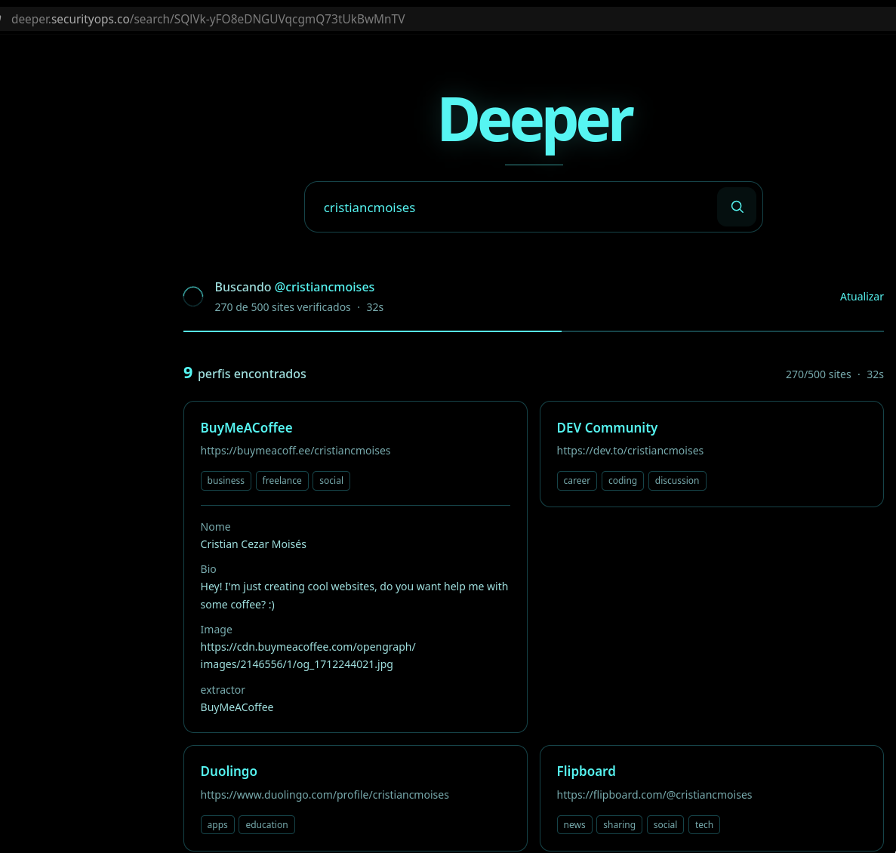

# Deeper 0.4.0

**English** | [Português (Brasil)](README.pt-BR.md)

Try the live application: **[deeper.securityops.co](https://deeper.securityops.co)**

Deeper is an independent, minimal web interface for **Maigret 0.6.6**. Enter a
username to check publicly accessible profile pages across supported sites.
Matching usernames do not prove that profiles belong to the same person; review
each result in context. Deeper does not perform recursive searches, use
authenticated platform cookies, or bypass access controls.

The interface uses a black-and-cyan design with an animated CSS title. The
search landing page is server-rendered without JavaScript. A pending results
page loads one same-origin script that appends new profiles and updates progress
without reloading the whole page. If JavaScript is unavailable, the HTML still
works and a manual refresh link remains available. Results are private to a
browser session and kept in memory; the application has no database, persistent
search history, or on-disk reports.

## Screenshots

The initial search screen:


A search in progress with results:



The displayed usernames and matches are examples, not identity verification.

## Quick deployment with Docker Compose

Requirements: Git, Docker Engine, and the Docker Compose plugin. The default
configuration binds to `127.0.0.1:8080`, so the service is not exposed directly
to the public internet.

```sh
git clone https://github.com/cristiancmoises/deeper.git
cd deeper
docker compose up -d --build
curl -fsS http://127.0.0.1:8080/health
```

Open <http://127.0.0.1:8080>. Follow startup output with
`docker compose logs -f deeper`, and stop the service with `docker compose down`.
The public source repository is on
[GitHub](https://github.com/cristiancmoises/deeper).

The default public-service profile runs **two searches at once**, accepts up to
**64 outstanding searches** across sessions, and allows **two outstanding
searches per browser session**. Outstanding means queued or running. The
container is limited to 512 MiB RAM and 1 GiB combined RAM and swap; size the host
for the reverse proxy, operating system, and other services as well.

For a lower-memory, single-search profile, create a local `.env` file beside
`compose.yaml` with:

```dotenv
DEEPER_WORKERS=1
DEEPER_MAX_JOBS=16
DEEPER_MAX_JOBS_PER_SESSION=2
```

Then run `docker compose up -d --build`. For a public self-hosted deployment,
put a reverse proxy with HTTPS in front of Deeper and set
`DEEPER_SECURE_COOKIE=1` in `.env`. Keep the app bound to loopback when the proxy
runs on the same host. If your proxy needs a non-loopback binding, restrict it
with a firewall and do not expose the plain HTTP port directly to the internet.

## What is included in 0.4.0

- A fair queue shares search workers across browser sessions. Each available
  worker takes a search from the pending session served least recently, keeping
  submission order within each session.
- Each session can have two queued or running searches by default. Repeating an
  active search or reusing a fresh completed result does not consume another
  slot. A third distinct outstanding search receives HTTP `429`; a full global
  queue receives HTTP `503`. Both responses include `Retry-After: 5`.
- Pending results show their current queue position, which updates as searches
  finish and other sessions join. A queue position is an ordering hint, not a
  promised start time.
- Incremental profiles, reusable isolated workers, 60-second completed-result
  reuse, and periodic in-memory cleanup remain available. Search coverage,
  connection limits, and timeouts retain their existing defaults.

The scheduling, session boundaries, and update format are described in
[`docs/ARCHITECTURE.md`](docs/ARCHITECTURE.md).

Measurements and methodology are documented in
[`docs/PERFORMANCE.md`](docs/PERFORMANCE.md). Docker image size and performance
on external platforms must be measured in your own environment. Builds also use
temporary storage and Docker cache; a smaller runtime does not eliminate that
cost. Inspect local usage with `docker system df` and
`docker image inspect deeper:0.4.0 --format '{{.Size}}'`. Deeper does not run
global Docker or VPS cleanup commands.

## Python installation

Deeper targets Python **3.11 and 3.12**. Install the pinned, hashed dependencies
and run the application:

```sh
python3 -m venv .venv
.venv/bin/python -m pip install --no-cache-dir --no-compile --require-hashes -r requirements.lock
.venv/bin/python -m pip install --no-cache-dir --no-compile --no-deps .
env PYTHONDONTWRITEBYTECODE=1 .venv/bin/python -m deeper
```

The environment does not need to be activated in fish. On Windows, use
`.venv\Scripts\python.exe`. `scripts/slim_runtime.py` is only for Deeper's
dedicated Docker runtime; it removes the pip installer and should not be run in
a shared environment.

To select a host and port:

```sh
env PYTHONDONTWRITEBYTECODE=1 .venv/bin/python -m deeper --host 0.0.0.0 --port 8080
```

`/health` reports whether the Maigret package is available; it does not check
connectivity to every platform. The commands above install the package from the
current checkout after installing its locked runtime dependencies.

## Searches, limits, and freshness

Defaults enable up to **500 sites**, **20 connections** per search, **two
simultaneous searches**, a **10-second per-site timeout**, and a **180-second
search deadline**. A watchdog terminates blocked processes after the deadline
plus 15 seconds for startup. Reusing a worker reduces startup overhead; it does
not make external sites respond faster. A cold search still pays the database
loading cost.

While a search is pending, new profiles are appended and progress updates about
once per second without a full-page reload. If JavaScript is disabled, use the
manual **Atualizar** link to get the latest server-rendered HTML; it does not
start another search. Select the title to return to the start page. If you
repeat a completed username in the same session within 60 seconds, the page
shows the result age; after that, it starts a new search. Set
`DEEPER_CACHE_TTL=0` to disable completed-result reuse. Results preserve the
distinction between CLAIMED, absent, and inconclusive.

At most two searches run at once by default; up to 64 queued or running jobs can
be accepted globally. A browser session may hold two of those outstanding slots.
When a worker becomes available, the session served least recently goes next,
with searches kept in submission order within each session. The current queue
position may change as other sessions join. These limits bound work; they do not
provide unlimited concurrent searches or guarantee public-site response times.

Jobs are private to the anonymous browser session and expire 15 minutes after
completion, with periodic cleanup within five seconds. Older completed results
may be evicted to free capacity. Warm workers retain memory until idle shutdown
or recycling. Restarting clears jobs and cache; without a persistent key, it also
invalidates sessions. Session quotas share capacity between browsers; they are
not identity verification or robust protection against bots opening new sessions.

Because jobs are held in memory, run a **single HTTP instance**;
`DEEPER_WORKERS` controls search concurrency. Sessions require cookies. There is
no recursive search, authenticated platform cookie support, or bypass
mechanism. Checks that require unconfigured DNS/Tor/I2P or an incompatible
username format may be skipped by Maigret and counted as processed checks.

## Configuration

| Variable | Default | Effect |
| --- | --- | --- |
| `DEEPER_TOP_SITES` | `500` | Maximum sites; `0` checks every enabled site. |
| `DEEPER_SITE_TIMEOUT` | `10` | Seconds per site. |
| `DEEPER_SEARCH_TIMEOUT` | `180` | Search deadline in seconds. |
| `DEEPER_CONNECTIONS` | `20` | Connections per search. |
| `DEEPER_WORKERS` | `2` | Concurrent searches. |
| `DEEPER_MAX_JOBS` | `64` | In-memory jobs, including queue and cache. |
| `DEEPER_MAX_JOBS_PER_SESSION` | `2` | Maximum queued or running searches per browser session. |
| `DEEPER_RETENTION` | `900` | Seconds to retain a completed job. |
| `DEEPER_CACHE_TTL` | `60` | Reuse completed results in the same session; `0` disables it. |
| `DEEPER_WORKER_MAX_JOBS` | `25` | Recycle a process after this many searches. |
| `DEEPER_WORKER_IDLE_TIMEOUT` | `120` | Shut down an idle process after this many seconds. |
| `DEEPER_SECRET_KEY` | random at startup | Optional session key to persist across restarts. |
| `DEEPER_SECURE_COOKIE` | `0` | Set to `1` when serving exclusively over HTTPS. |

Compose accepts settings from the environment or a local `.env` file. Changing
site limits, extraction behavior, timeouts, or connection counts can affect
coverage and reliability. The fair queue changes admission and scheduling, while
preserving search coverage, extraction, timeouts, and connection defaults.

## Validation and license

[`docs/VALIDATION.md`](docs/VALIDATION.md) records the validation performed
for 0.3.0. The test suite uses real Maigret code against local HTTP
fixtures with synthetic profiles. `tests/verify_ui.py` uses Playwright as an
external QA tool; it does not add scripts to the page.

Deeper is an independent interface and is not the official Maigret project.
The backend is **Maigret 0.6.6**, an MIT-licensed project by **Soxoj**. Thank
you to Soxoj for making the project available under the MIT license. See
[`THIRD_PARTY_NOTICES.md`](THIRD_PARTY_NOTICES.md), [`LICENSE`](LICENSE), and
[`LICENSE-MAIGRET`](LICENSE-MAIGRET) for attribution and license terms.
