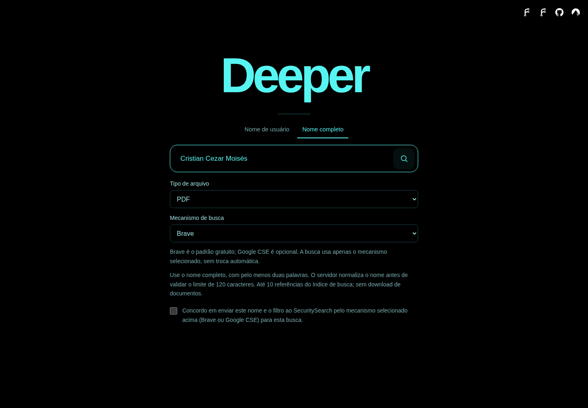
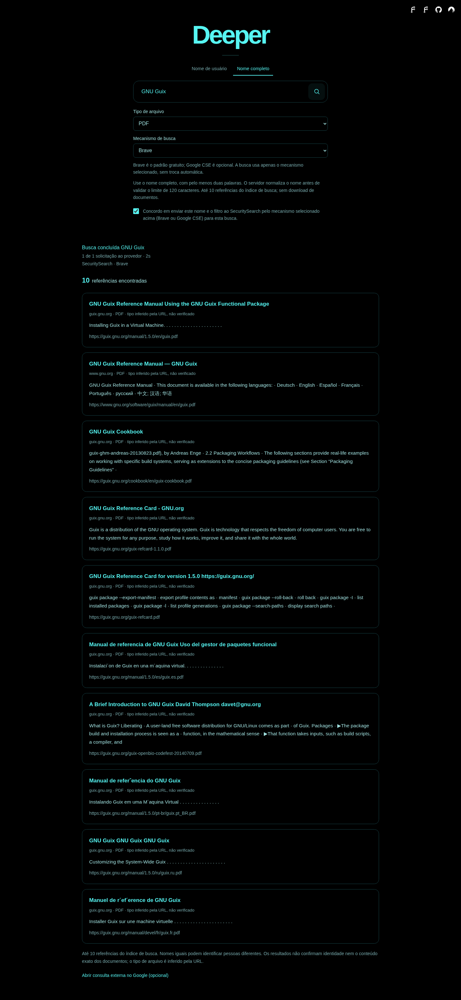

# Deeper 0.5.0

[English](README.md) | **Português (Brasil)**

Experimente a aplicação: **[deeper.securityops.co](https://deeper.securityops.co)**

Consulte a versão em `/health` da aplicação implantada e o
[`registro de validação`](docs/pt-BR/VALIDATION.md) para identificar a versão em produção.

O Deeper é uma interface web independente com dois modos. **Nome de usuário**
usa o **Maigret 0.6.6** para verificar perfis públicos. **Nome completo e
documentos** usa **SecuritySearch**, com **Brave gratuito** por padrão ou
**Google CSE gratuito** opcional por busca, para encontrar até **10 referências do índice
de busca**, com um seletor para qualquer tipo, PDF, DOC, DOCX, XLS, XLSX, PPT,
PPTX, ODT, ODS, ODP, RTF, TXT ou CSV. Nomes iguais não provam que os perfis pertencem
à mesma pessoa; avalie cada resultado no contexto. Uma referência por nome não
comprova identidade nem conteúdo do documento, mesmo com o nome exato na consulta.
O Deeper não deduz usuários a partir de nomes, não baixa nem pré-visualiza
documentos, não acessa URLs dos resultados, não faz buscas recursivas, não usa
cookies autenticados de plataformas e não contorna controles de acesso.

A interface tem fundo preto, detalhes em ciano e título animado em CSS. A página
inicial da busca é renderizada no servidor sem JavaScript. Enquanto há uma
pesquisa pendente, a página de resultados carrega um script da mesma
origem específico do modo para acrescentar resultados e atualizar o progresso sem recarregar a página
inteira. Sem JavaScript, o HTML continua funcional e há um link de atualização
manual. Os resultados são privados à sessão do navegador e ficam em memória;
a aplicação não tem banco de dados, histórico persistente nem relatórios em disco.

## Capturas de tela

Estas capturas da **0.5.0** mostram a aplicação local real em Chromium com sandbox.

Formulário por nome com “Cristian Cezar Moisés”, PDF e Brave selecionados e
consentimento desmarcado. É uma demonstração do formulário, não achados de
documentos sobre essa pessoa:



Resultados reais Brave para o exemplo público não pessoal “GNU Guix”, entre
aspas e com filtro PDF: dez referências do índice de busca. Os tipos são inferidos
pelas URLs; os documentos não foram baixados e seu conteúdo ou MIME não foi verificado:



## Deploy rápido com Docker Compose

Requisitos: Git, Docker Engine e plugin Docker Compose. Os dois modos funcionam
sem conta ou chave do provedor; nenhuma API paga é usada. O padrão
usa `127.0.0.1:8080`, sem expor o serviço diretamente à internet pública.

```sh
git clone https://github.com/cristiancmoises/deeper.git
cd deeper
cp .env.example .env
# Opcional: edite .env para ajustar limites de recursos.
docker compose up -d --build
curl -fsS http://127.0.0.1:8080/health
```

Abra <http://127.0.0.1:8080>. Acompanhe a inicialização com
`docker compose logs -f deeper` e pare o serviço com `docker compose down`.
Mantenha o `.env` privado; o Git o ignora. Os espelhos públicos do código estão no
[GitHub](https://github.com/cristiancmoises/deeper),
[Codeberg](https://codeberg.org/berkeley/deeper),
[Security Ops](https://git.securityops.co/cristiancmoises/deeper) e
[Security Ops Brasil](https://git.securityops.com.br/cristiancmoises/deeper).
Os links identificam os repositórios públicos do projeto.

O perfil padrão do serviço público executa **duas buscas por vez**, aceita até
**64 buscas pendentes** no total e permite **duas buscas pendentes por sessão
do navegador**. Pendentes são as buscas na fila ou em execução. O container tem
limite de 512 MiB de RAM e 1 GiB de RAM e swap somados; dimensione o host também
para o proxy reverso, o sistema operacional e os demais serviços.

Para um perfil com menor uso de memória e uma busca por vez, acrescente estas
configurações ao `.env` local ao lado de `compose.yaml`:

```dotenv
DEEPER_WORKERS=1
DEEPER_MAX_JOBS=16
DEEPER_MAX_JOBS_PER_SESSION=2
```

Depois execute `docker compose up -d --build`. Para disponibilizar sua própria
instância publicamente, coloque um proxy reverso com HTTPS na frente do Deeper
e defina `DEEPER_SECURE_COOKIE=1` no `.env`. Mantenha o app em loopback quando o
proxy estiver no mesmo host. Se o proxy exigir um bind fora do loopback, restrinja
o acesso com firewall; não exponha a porta HTTP sem TLS diretamente à internet.

## Nome completo, privacidade e limites do provedor

Selecione o modo de nome completo e informe pelo menos duas palavras, com 2 a
120 caracteres. O Deeper normaliza Unicode para NFC e espaços. Aceita letras,
marcas combinantes, espaços, apóstrofos, hífens e pontos; rejeita aspas e operadores
de consulta. O nome inteiro fica entre aspas, e o tipo de arquivo permitido é o
único operador acrescentado. É obrigatório consentir antes de compartilhar o nome
e o filtro com SecuritySearch e o mecanismo selecionado. As políticas desses serviços se aplicam a esse
processamento externo.

Cada tarefa por nome sem cache faz **um GET** para
`https://securityops.co/api/v1/web`, com a consulta entre aspas em `s`,
`scraper=brave` (padrão) ou `scraper=google` (Google CSE) e `extendedsearch=no`.
Não exige conta ou chave, não usa API paga, repetição automática nem troca
automática de mecanismo. O Google CSE pode limitar requisições; o Deeper informa
indisponibilidade ou cota honestamente. Os resultados mostram o mecanismo real;
resultados Brave nunca são rotulados como Google. A resposta é limitada a 1 MiB.
O timeout HTTP padrão é de 12 segundos, configurável de 1 a 30: um timeout normal
do `urllib`, não um prazo absoluto imposto por processo. O link opcional de consulta
externa no Google abre resultados adicionais fora do Deeper e do seu limite;
ele não identifica o mecanismo das referências exibidas.

Referências contêm identificador baseado na URL, título, URL, trecho, host de
origem e tipo de arquivo inferido. Duplicatas são removidas por URL, não título
ou host. Extensões conhecidas incompatíveis com o filtro são removidas; tipos
desconhecidos continuam identificados como não verificados. Extensão ou filtro
não comprova MIME da resposta nem conteúdo do documento. Índices podem omitir,
atrasar ou atribuir resultados incorretamente. Busca vazia não comprova ausência.

A proteção de recursos permite **100 chamadas externas por dia UTC por processo
da aplicação**, com pelo menos **um segundo entre chamadas**. Reiniciar zera o
contador. Essa proteção limita recursos compartilhados, não cobrança: a integração
não usa API paga. O serviço e os mecanismos podem ficar indisponíveis.
Limites esgotados, falhas de rede e respostas inválidas produzem
erros públicos genéricos, nunca resultados inventados.

## Agendamento compartilhado na 0.5.0

Os dois modos compartilham o mesmo executor limitado e vagas de execução. Uma
requisição HTTP por nome não cria outro pool. A chave de cache inclui sessão,
modo, valor normalizado, tipo de arquivo e mecanismo selecionado. O progresso por nome conta uma única
requisição ao provedor (0/1 ou 1/1), em vez dos sites verificados pelo Maigret.

- Uma fila justa compartilha os workers entre sessões do navegador. Cada
  worker disponível recebe uma busca da sessão pendente atendida há mais tempo,
  preservando a ordem de envio dentro de cada sessão.
- Cada sessão pode ter duas buscas na fila ou em execução por padrão. Repetir
  uma busca ativa ou reutilizar um resultado recente não ocupa outra vaga. Uma
  terceira busca pendente distinta recebe HTTP `429`; a fila global cheia
  retorna HTTP `503`. As duas respostas incluem `Retry-After: 5`.
- Os resultados pendentes mostram a posição atual na fila, atualizada conforme
  buscas terminam e outras sessões entram. A posição indica a ordem atual, sem
  prometer um horário de início.
- Continuam disponíveis perfis incrementais, workers isolados reutilizáveis,
  reutilização de resultados concluídos por 60 segundos e limpeza periódica em
  memória. Cobertura, conexões e timeouts mantêm os padrões existentes.

O agendamento, os limites das sessões e o formato das atualizações estão em
[`docs/pt-BR/ARCHITECTURE.md`](docs/pt-BR/ARCHITECTURE.md).

As medições e o método estão em
[`docs/pt-BR/PERFORMANCE.md`](docs/pt-BR/PERFORMANCE.md). O tamanho da imagem Docker e o
desempenho em plataformas externas precisam ser medidos no seu ambiente. Builds
também usam armazenamento temporário e cache do Docker; um runtime menor não
elimina esse custo. Consulte o uso local com `docker system df` e
`docker image inspect deeper:0.5.0 --format '{{.Size}}'`. O Deeper não executa
limpeza global do Docker ou da VPS.

## Instalação Python

O Deeper é destinado ao Python **3.11 e 3.12**. Instale as dependências fixadas
com hashes e execute a aplicação:

```sh
python3 -m venv .venv
.venv/bin/python -m pip install --no-cache-dir --no-compile --require-hashes -r requirements.lock
.venv/bin/python -m pip install --no-cache-dir --no-compile --no-deps .
env PYTHONDONTWRITEBYTECODE=1 .venv/bin/python -m deeper
```

Não é necessário ativar o ambiente no fish. No Windows, use
`.venv\Scripts\python.exe`. `scripts/slim_runtime.py` serve exclusivamente
para o runtime Docker dedicado do Deeper: ele remove o instalador pip e não deve
ser executado em um ambiente compartilhado.

Para definir host e porta:

```sh
env PYTHONDONTWRITEBYTECODE=1 .venv/bin/python -m deeper --host 0.0.0.0 --port 8080
```

`/health` informa a disponibilidade dos pacotes; não verifica conectividade do
SecuritySearch ou dos mecanismos nem cobertura. O `.env` é lido pelo Compose,
não automaticamente pelo Python. O início direto por Python não exige chave do
provedor; exporte os ajustes opcionais de recursos ao alterar seus padrões.
Os comandos acima instalam o pacote a partir do checkout
atual, após instalar as dependências de runtime fixadas.

## Buscas, limites e atualização dos resultados

O padrão do modo de usuário habilita até **500 sites**, **20 conexões** por busca, **duas buscas
simultâneas**, timeout de **10 segundos por site** e prazo de **180 segundos
por busca**. Um watchdog encerra processos bloqueados após o prazo mais
15 segundos de inicialização. Reutilizar workers reduz o custo de inicialização;
não acelera a resposta de sites externos. Uma busca fria ainda paga o custo de
carregar a base.

Enquanto uma busca está pendente, novos perfis são acrescentados e o progresso é
atualizado aproximadamente a cada segundo, sem recarregar a página inteira. Se
JavaScript estiver desativado, use o link manual **Atualizar** para obter o HTML
mais recente; isso não inicia outra busca. Clique no título para voltar ao início.
Se repetir um usuário já pesquisado na mesma sessão em até 60 segundos, a página
mostra a idade do resultado; depois desse prazo, uma nova busca é iniciada. Use
`DEEPER_CACHE_TTL=0` para desativar a reutilização após conclusão. Os resultados
preservam a distinção entre CLAIMED, ausente e inconclusivo.

Por padrão, no máximo duas buscas executam ao mesmo tempo; até 64 tarefas na
fila ou em execução podem ser aceitas globalmente. Uma sessão do navegador pode
ocupar duas dessas vagas. Quando um worker fica disponível, a sessão atendida
há mais tempo é escolhida, preservando a ordem de envio dentro de cada sessão.
A posição atual na fila pode mudar com a entrada de outras sessões. Os limites
delimitam o trabalho; não oferecem buscas simultâneas ilimitadas nem garantem
prazos de resposta dos sites públicos.

As tarefas são privadas à sessão anônima do navegador e expiram 15 minutos após
a conclusão, com limpeza periódica em até cinco segundos. Resultados concluídos
mais antigos podem ser descartados para liberar capacidade. Workers aquecidos
mantêm memória até serem encerrados por ociosidade ou reciclagem. Reiniciar limpa
tarefas e cache; sem chave persistente, também invalida as sessões. As cotas por
sessão compartilham a capacidade entre navegadores; não verificam identidade nem
impedem de forma robusta bots que abrem novas sessões.

Como as tarefas ficam em memória, execute uma **única instância HTTP**;
`DEEPER_WORKERS` controla a concorrência das buscas. As sessões exigem cookies.
Não há busca recursiva, suporte a cookies autenticados de plataformas
ou mecanismo de bypass. Verificações que exigem DNS/Tor/I2P sem configuração ou
formato incompatível de nome de usuário podem ser ignoradas pelo Maigret e
contadas como verificações processadas.

## Configuração

| Variável | Padrão | Efeito |
| --- | --- | --- |
| `DEEPER_NAME_DAILY_LIMIT` | `100` | Máximo positivo de chamadas por dia UTC por processo; zera no reinício. |
| `DEEPER_NAME_TIMEOUT` | `12` | Timeout HTTP finito em segundos, de `1` a `30`. |
| `DEEPER_TOP_SITES` | `500` | Limite de sites por usuário; `0` verifica todos os habilitados. |
| `DEEPER_SITE_TIMEOUT` | `10` | Segundos por site. |
| `DEEPER_SEARCH_TIMEOUT` | `180` | Prazo da pesquisa em segundos. |
| `DEEPER_CONNECTIONS` | `20` | Conexões por pesquisa. |
| `DEEPER_WORKERS` | `2` | Buscas simultâneas compartilhadas entre os dois modos. |
| `DEEPER_MAX_JOBS` | `64` | Tarefas em memória, incluindo fila e cache. |
| `DEEPER_MAX_JOBS_PER_SESSION` | `2` | Máximo de buscas na fila ou em execução por sessão do navegador. |
| `DEEPER_RETENTION` | `900` | Segundos para manter uma tarefa concluída. |
| `DEEPER_CACHE_TTL` | `60` | Reutiliza resultados na mesma sessão; `0` desativa. |
| `DEEPER_WORKER_MAX_JOBS` | `25` | Recicla o processo após esse número de buscas. |
| `DEEPER_WORKER_IDLE_TIMEOUT` | `120` | Encerra um processo ocioso após esse prazo. |
| `DEEPER_SECRET_KEY` | aleatória ao iniciar | Chave persistente opcional para execução Python direta. |
| `DEEPER_SECURE_COOKIE` | `0` | Defina `1` quando servir exclusivamente por HTTPS. |

O Compose aceita configurações do ambiente ou de um `.env` local. Alterar limite
de sites, extração, timeouts ou conexões pode afetar cobertura e confiabilidade.
A fila justa altera a admissão e o agendamento, preservando os padrões de
cobertura, extração, timeouts e conexões.

## Validação e licença

[`docs/pt-BR/VALIDATION.md`](docs/pt-BR/VALIDATION.md) descreve a validação da
0.5.0 e distingue fixtures automatizadas, observações reais do provedor e
qualificação da versão/implantação. A suíte usa Maigret real com HTTP local e respostas controladas do
provedor; isso não é evidência de SecuritySearch real. Os scripts de QA usam Playwright
externamente, sem adicionar scripts à página.

O Deeper é uma interface independente, não é o projeto oficial Maigret. O
backend é o **Maigret 0.6.6**, projeto sob licença MIT de **Soxoj**. Agradecemos
ao Soxoj por disponibilizar o projeto sob a licença MIT. Consulte
[`THIRD_PARTY_NOTICES.pt-BR.md`](THIRD_PARTY_NOTICES.pt-BR.md), [`LICENSE`](LICENSE)
e [`LICENSE-MAIGRET`](LICENSE-MAIGRET) para créditos e termos das licenças.
Agradecemos ao [SecuritySearch](https://securityops.co) pelo serviço externo de
busca. O Deeper chama seu endpoint público; o código do SecuritySearch não está
embutido nem coberto pela licença MIT do Deeper.
O próprio Deeper tem licença MIT. Os ícones dos links de código mantêm seus
termos: Forgejo CC BY-SA 4.0, Codeberg CC0 e termos de uso do logo GitHub,
documentados nos avisos de terceiros.
